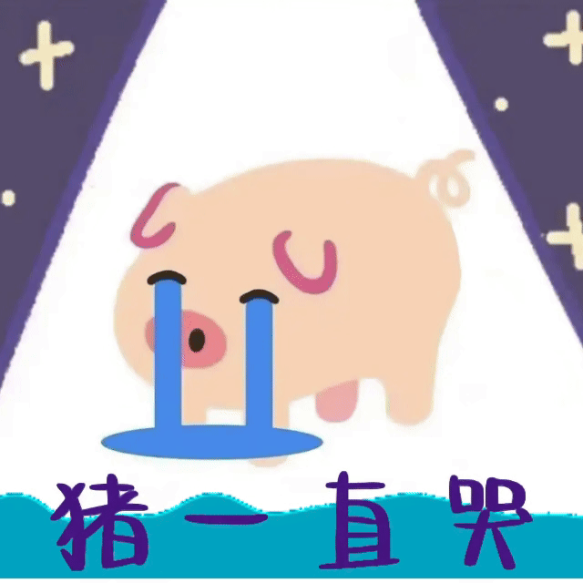

# SUCH A CRAZY DAY!
## 一个悲伤的晚上

### 为什么悲伤
因为搞了一晚上 Git!<br>
但还要学 Markdown.......<br>
[Markdown 语法](https://markdown.com.cn)
#### 先写一段 C 语言<br>
```c
#include <stdio.h>
int main(void)
{

	printf("Hello World\n");
	return 0;
}
```
##### 还有一个表格。。。

| 1 | 2 | 3 | 4 |
| :--- | :--- | :--- | :--- |
| @ | # | $ | % |
| ^ | & | * | ~ |

***over***
